# Data Model

PostgreSQL 17. The schema changes only through Flyway migrations (`src/main/resources/db/migration`).

## ER Diagram

```mermaid
erDiagram
    app_user ||--o{ sale : records
    app_user |o--o{ sale : cancels
    app_user |o--o{ purchase : cancels
    app_user ||--o{ purchase : records
    app_user ||--o{ account_event : "changed in"
    app_user ||--o{ account_event : "made by"
    app_user ||--o{ notification : receives
    app_user |o--o{ notification : causes
    app_user ||--o{ inventory_movement : performs
    app_user ||--o{ refresh_token : owns
    app_user ||--o{ cash_drawer : opens
    app_user ||--o{ cash_drawer : "is responsible for"
    app_user |o--o{ cash_drawer : closes
    cash_drawer ||--|{ cash_drawer_member : "sold from by"
    app_user ||--o{ cash_drawer_member : "sells from"
    cash_drawer |o--o{ sale : "receives the cash of"
    cash_drawer |o--o{ sale : "refunds"
    category ||--o{ product : groups
    supplier ||--o{ purchase : supplies
    purchase ||--|{ purchase_item : contains
    product ||--o{ purchase_item : "purchased in"
    customer ||--o{ sale : places
    sale ||--|{ sale_item : contains
    product ||--o{ sale_item : "sold in"
    product ||--o{ inventory_movement : "ledger of"
    purchase |o--o{ inventory_movement : originates
    sale |o--o{ inventory_movement : originates

    app_user {
        bigint id PK
        varchar name
        varchar email UK "case-insensitive"
        varchar password_hash "BCrypt"
        varchar role "ADMIN | SUPERVISOR | SELLER"
        boolean active
        boolean password_change_required "temporary password set by an admin (V26)"
        int credentials_version "access tokens carry it; older ones are refused (V27)"
        timestamptz created_at
        timestamptz updated_at
    }

    account_event {
        bigint id PK
        bigint user_id FK "the account changed"
        bigint actor_id FK "admin, or the user themself"
        varchar type "CREATED | EMAIL_CHANGED | PHONE_CHANGED | ROLE_CHANGED | DEACTIVATED | REACTIVATED | PASSWORD_RESET | PASSWORD_CHANGED | PASSWORD_RECOVERED (V30)"
        varchar old_value "email, phone or role before; TEMPORARY for a changed temporary password"
        varchar new_value "email, phone or role after"
        timestamptz occurred_at
    }

    notification {
        bigint id PK
        bigint recipient_id FK
        bigint actor_id FK "who caused it; nullable"
        varchar type "SALE_CANCELLED | PURCHASE_CANCELLED | CASH_DRAWER_ASSIGNED | CASH_DRAWER_CLOSED | EMAIL_CHANGED | PHONE_CHANGED | PASSWORD_RESET (V31)"
        bigint subject_id "sale, purchase or drawer"
        varchar subject_label "sale number, supplier, responsible's name or business date"
        numeric amount "total, opening float or cash difference"
        varchar reason "cancellation reason"
        timestamptz created_at "when the change committed"
        timestamptz read_at "null while unread"
    }

    category {
        bigint id PK
        varchar name UK "case-insensitive"
        varchar description
        numeric default_tax_rate "suggested VAT for new products"
        bigint version "optimistic lock (V3)"
        boolean active
        timestamptz created_at
        timestamptz updated_at
    }

    product {
        bigint id PK
        varchar sku UK
        varchar barcode UK "8-14 digits, optional"
        varchar name
        varchar description
        varchar image_url "object storage URL, optional"
        bigint category_id FK
        numeric sale_price "pre-tax"
        numeric tax_rate "fraction, usually 0 or 0.16"
        int stock "CHECK >= 0, atomic UPDATE only"
        numeric average_cost "weighted, 4 decimals, purchases only"
        int min_stock "low-stock alert"
        boolean active
        bigint version "optimistic lock"
        timestamptz created_at
        timestamptz updated_at
    }

    supplier {
        bigint id PK
        varchar name
        varchar tax_id UK "uppercase, optional"
        varchar email
        varchar phone
        varchar address
        boolean active
        bigint version "optimistic lock (V5)"
        timestamptz created_at
        timestamptz updated_at
    }

    customer {
        bigint id PK
        varchar name
        varchar tax_id UK "uppercase, optional"
        varchar email
        varchar phone
        varchar address
        varchar fiscal_postal_code "with tax_id and tax_regime, or none (V15)"
        varchar tax_regime "SAT c_RegimenFiscal code (V15)"
        boolean active
        bigint version "optimistic lock (V6)"
        timestamptz created_at
        timestamptz updated_at
    }

    purchase {
        bigint id PK
        bigint supplier_id FK
        bigint user_id FK
        timestamptz purchase_date
        numeric total
        varchar status "COMPLETED | CANCELLED (V22)"
        timestamptz cancelled_at "set when cancelled"
        bigint cancelled_by FK "set when cancelled"
        varchar cancellation_reason "set when cancelled"
        uuid idempotency_key UK "optional"
    }

    purchase_item {
        bigint id PK
        bigint purchase_id FK
        bigint product_id FK
        int quantity "> 0"
        numeric unit_cost
        numeric subtotal "= quantity * unit_cost"
    }

    sale {
        bigint id PK
        bigint sale_number UK "DB sequence"
        bigint customer_id FK
        bigint user_id FK
        timestamptz sale_date
        numeric subtotal
        numeric tax "sum of item taxes"
        numeric total "= subtotal + tax"
        varchar payment_method "CASH | CARD | TRANSFER"
        varchar status "COMPLETED | CANCELLED"
        timestamptz cancelled_at "set when cancelled"
        bigint cancelled_by FK "set when cancelled"
        varchar cancellation_reason "set when cancelled"
        uuid idempotency_key UK "required (V7)"
        bigint cash_drawer_id FK "drawer its cash went into (V14)"
        bigint cancellation_drawer_id FK "drawer its refund came out of (V14)"
    }

    sale_item {
        bigint id PK
        bigint sale_id FK
        bigint product_id FK
        int quantity "> 0"
        numeric unit_price "snapshot at sale time"
        numeric tax_rate "snapshot at sale time"
        numeric subtotal "= quantity * unit_price"
        numeric tax "= ROUND(subtotal * tax_rate, 2)"
    }

    refresh_token {
        bigint id PK
        bigint user_id FK
        varchar token_hash UK "SHA-256, raw token never stored"
        timestamptz expires_at
        timestamptz revoked_at "set on rotation or logout"
        varchar revocation_reason "ROTATED | LOGOUT | SESSIONS_REVOKED"
        timestamptz session_started_at "login it descends from (V20)"
        timestamptz created_at
    }

    inventory_movement {
        bigint id PK
        bigint product_id FK
        varchar type "PURCHASE | PURCHASE_CANCEL | SALE | SALE_CANCELLATION | ADJUSTMENT"
        int quantity "+ in / - out"
        int resulting_stock "from UPDATE RETURNING"
        bigint purchase_id FK "optional"
        bigint sale_id FK "optional"
        varchar reason "required for ADJUSTMENT"
        uuid idempotency_key UK "optional, ADJUSTMENT only (V8)"
        bigint user_id FK
        timestamptz movement_date "clock_timestamp()"
    }

    cash_drawer {
        bigint id PK
        bigint responsible_id FK "a member; counts and closes it (V14)"
        bigint opened_by FK "the responsible or a manager (V14)"
        date business_date "local day (store time zone)"
        numeric opening_float ">= 0"
        timestamptz opened_at
        timestamptz closed_at "set when closed"
        bigint closed_by FK "set when closed"
        numeric expected_cash "snapshot at closing"
        numeric counted_cash "set when closed"
        varchar closing_note "optional"
    }

    cash_drawer_member {
        bigint cash_drawer_id PK, FK
        bigint user_id PK, FK "UK with business_date"
        date business_date "copy of the drawer's"
        boolean drawer_open "copy of the drawer's state"
    }
```

## Design Decisions

| Decision | Why |
|---|---|
| Stock decremented with `UPDATE ... SET stock = stock - :qty WHERE id = :id AND stock >= :qty RETURNING stock`, backed by `CHECK (stock >= 0)` | Two sellers selling the last unit at once: only one succeeds. |
| `Product.stock` mapped `insertable = false, updatable = false` | Otherwise an admin editing the price could overwrite stock with a stale value and silently undo sales. |
| `product.average_cost` (weighted average, `NUMERIC(14,4)`, not mapped by JPA) moves in the purchase's stock `UPDATE`: `(stock * average_cost + qty * unit_cost) / (stock + qty)` with the old values, or the new cost when there were no units; a purchase cancellation takes `qty * unit_cost` back out, `(stock * average_cost - qty * unit_cost) / (stock - qty)`, but only while no unit of the product was sold or written off since that purchase (those left at the average, part of it this purchase's cost, so taking it out again would undervalue the rest; other purchase cancellations left at their own cost and don't count) and some units would remain; otherwise it leaves it. It locks the product row in a statement of its own first, so the ledger check sees every movement committed before it; movement ids follow each product's order, since every movement is inserted under its row lock; sales, sale cancellations and adjustments leave it as is. `sale_item.unit_cost` is stamped by the sale's stock `UPDATE` (a data-modifying CTE) | Both read and write the cost under the product's row lock, so concurrent purchases and sales never average or snapshot a stale cost. Four decimals keep repeated averaging from drifting. Lines sold before V16, or of products never purchased, keep a `NULL` cost: reports treat it as unknown, never as zero. |
| `version` on product, category, supplier and customer; clients send the version they loaded | Concurrent catalog edits are detected (409) instead of silently overwritten; doesn't cover stock, so it never conflicts with sales. |
| Category locked before product: FOR SHARE to assign/activate a product, FOR UPDATE to deactivate | An active product never ends up in an inactive category, even under concurrent edits. |
| Purchases lock the supplier and sales the customer `FOR SHARE` before any product | The supplier or customer can't be deactivated while a document that uses it is being recorded. |
| Lock products in `product_id` order; `lock_timeout = 5s` | Prevents deadlocks between multi-product sales and endless waits on hot rows. |
| Stock written only by `InventoryMovementRepository`: one CTE per line (`UPDATE product ... AND active RETURNING stock` + `INSERT inventory_movement`) | The stock change and its movement happen while the row is locked, so `resulting_stock` is exact under concurrency and no movement can be forgotten. |
| Idempotency: transaction-scoped advisory lock on `scope:key`, then lookup; same key with a different payload → 409 | Concurrent retries (double click) record exactly one document. |
| `idempotency_key` on sale (required, V7) and purchase (optional) | A double click or retry returns the existing document instead of creating a duplicate. Double clicks are common at the checkout; purchases are recorded only by admins. A sale key reused by another seller is a 409, so it never reveals their sale. |
| Atomic cancellation (`UPDATE sale SET status = 'CANCELLED', cancelled_at, cancelled_by, cancellation_reason WHERE id = :id AND status = 'COMPLETED'`) + unique index per (sale, product, type) | Concurrent cancellations can't return stock twice; who, when and why is always recorded (enforced by `ck_sale_status`). Purchases follow the same rule (`ck_purchase_status`, unique index per (purchase, product, type), V22-V25). |
| Only ADMIN changes a customer's tax ID or `active` flag (403 for sellers) | Sales reference the customer, so past receipts show its current tax ID; deactivating it blocks every checkout. Sellers still register customers and fix contact data. |
| Cancellation returns stock even to products deactivated after the sale | The goods are physically back on the shelf; the product just can't be sold until it's reactivated. |
| A purchase cancellation takes all its units out or none: if a product has fewer units left than the purchase brought (409), nothing changes. It applies to products deactivated since, and the purchases summary leaves cancelled purchases out | Stock never goes negative; units already sold can't go back to the supplier, so a partial cancellation would leave the purchase half true. A manager corrects that case with a manual adjustment. |
| `barcode` (optional, unique, 8-14 digits) separate from `sku` | Grocery items are sold by scanning; `sku` stays as the internal code, also for unlabeled items. |
| `image_url` only; images live in object storage (Cloudinary/S3) | Binary files bloat and slow down the DB. |
| `payment_method` on sale | Needed for reports and cash closing. |
| `resulting_stock` from `RETURNING`; `movement_date` uses `clock_timestamp()` | The ledger stays consistent and correctly ordered under concurrency. |
| `sale_number` from a DB sequence, mapped with `@Generated(event = INSERT)` | `MAX()+1` duplicates numbers; `@Generated` reads the value back. |
| `unit_price` and `tax_rate` copied into `sale_item`, read before the product row is locked | Past sales keep their original price and tax. A price edited at the same instant leaves the sale with the price the checkout saw, which is acceptable. |
| Seeded grocery categories with `default_tax_rate` (Pantry, Dairy, Bakery 0%; Beverages, Snacks, Cleaning, Personal Care 16%) | Pre-fills the product VAT so classification errors are less likely; each product can still override it. |
| Refresh tokens stored as SHA-256 hashes, rotated on every use; reuse of a `ROTATED` token revokes all of the user's sessions; expired ones deleted daily. Every rotated token keeps its login's `session_started_at` and expires by `app.jwt.max-session-age` after it at the latest (V20) | Stolen refresh tokens are detected without logging users out for a stale logged-out token; a DB leak doesn't expose usable tokens. Screens that poll the API refresh the session on their own, so without a maximum a browser left signed in would stay signed in forever. |
| An admin resets a forgotten password to a temporary one the user must change before anything else: `password_change_required` (V26) travels as the access token's `pwd_change` claim, and `PasswordChangeInterceptor` answers 403 to every endpoint but the profile, the own password change and the public auth ones. The reset revokes the user's sessions and pending reset codes (so does every password change); an email change revokes the codes too. The new password must differ from the current one; access tokens issued before stop working at once (`credentials_version`, below) | The admin who typed the temporary password can't use the account without the user noticing (they're emailed about the reset, and the history marks the change of a temporary password), and a user without access to their email or phone can still get back in. The claim is fixed in each token, which is fine because the reset ends every session and the next login carries it. Codes sent to an old address must not reset the password. |
| `app_user.credentials_version` (V27) goes up on a password change, reset or recovery, a role change and a deactivation; access tokens carry it (claim `cv`) and `CredentialsVersionValidator`, in the `JwtDecoder`, refuses an older one (401) | Those changes take effect at once instead of when the 15-minute access token expires (its refresh token is revoked too, so the session ends). It costs one primary-key read per authenticated request, fine for a store's few users; tokens issued before V27 have no claim and match version 0. |
| Every account change goes to `account_event` (V28, V30) in the same transaction through `AccountEventRecorder`: who (`actor_id`; the user themself for their own change or a forgotten-password reset, the admin for anything else; the initial admin creates itself), what, before/after for email, phone and role, when. A changed phone also ends pending reset codes (it receives them by SMS). Read by admins only (`GET /users/{id}/events`, always newest first) | An admin can take over another account (change its email, reset its password), and the trail shows who did. Written with the change, so it can't be skipped or left out by a rollback. |
| Notifications (V31) are saved after the change commits, in the background (at most 2 at once), never to the actor; the web writes the text from `type` and the generic values (`subject_id`, `subject_label`, `amount`, `reason`, meaning per type in `NotificationType`). `PURCHASE_CANCELLED` is filtered on read by the token's role; read ones go after 30 days, any after 90 | A rolled-back change tells no one, and a failed save never undoes or slows a cancellation or closing; saving in the request's thread would hold a second pool connection. Filtering on read can't race with a save in flight the way deleting on a role change could, and a demoted manager stops seeing purchase costs at once. One table with typed values keeps adding a type to a new enum value and a CHECK. |
| An admin's email change is told to the old address, and a phone change or password reset to the account's email, after the change commits and in the background (`AccountChangeNotifier`), bilingual since users have no language setting and with new values masked; without SMTP it's only logged | A takeover through the email, the phone or a reset doesn't go unnoticed, the old (maybe compromised) address doesn't learn the new one, and a slow or failing mail server never holds or undoes the change. |
| Login checks the credentials version and status again under the user lock before issuing tokens; the public `/auth` endpoints ignore any bearer token (`PublicEndpointsBearerTokenResolver`) | A password change committed while BCrypt checked the old one can't leave that login a session, and a token a change just made invalid doesn't turn signing in again or out into a 401. |
| Emails stored lowercase (`CHECK (email = LOWER(email))`) with a plain unique index | Case-insensitive uniqueness and indexed login lookups. |
| VAT rate per product (`tax_rate`: 0% basic food, 16% general); tax computed and rounded per line (HALF_UP); `sale.tax` = sum of line taxes | Mexican grocery store: sugar or rice pay 0%, soda or snacks 16%. |
| Money as `NUMERIC(12,2)` / `BigDecimal`; `sale_price` is pre-tax | No floating-point rounding errors; totals computed server-side. |
| Manual adjustments are signed `ADJUSTMENT` movements (one atomic CTE with `stock + qty >= 0`), allowed on inactive products | Shrinkage, damage and count differences are corrected without ever going negative; discontinued products still need their remaining units written off. |
| Optional `Idempotency-Key` on adjustments, stored on the movement (V8, partial unique index, only for `ADJUSTMENT`) | A retried "-5 damaged" must not remove 10 units. Adjustments have no document table, so the key lives on the movement; the partial index keeps sale and purchase rows out. |
| Stock ledger read per product (404 if the product doesn't exist) or by type across the store over at most 366 days (`productId`, or `type` with `from` and `to`), newest first, in one `REPEATABLE READ` snapshot | Uses `ix_inventory_movement_product_date` or `ix_inventory_movement_type_date` (V19); a store-wide ledger without a type would scan the most write-heavy table. The page and its total count come from the same snapshot. Offset paging over a growing ledger can shift: clients keep the first request's `to` while paging. |
| `product.stock` is `INTEGER` | Overflow needs over 2.1 billion units of one product; accepted, it would surface as a generic 409. |
| Sales reports aggregate in SQL inside one `REPEATABLE READ` read-only transaction with a 10 s timeout; the period is validated before it starts | Totals and breakdowns come from the same snapshot, so they agree even while sales are being recorded; no sale rows are loaded into memory. A heavy or invalid report never holds a pool connection the checkout needs. |
| Report days follow `app.store.time-zone` (a region ID such as `America/Mexico_City`; offsets are rejected); periods are inclusive calendar days, up to 366, between 2000-01-01 and 9999-12-30 | Dates are stored in UTC, but "sales on Oct 1" means the store's local day. PostgreSQL converts both the period bounds and each sale's day (`AT TIME ZONE`), so filter and daily breakdown always agree; it reads offsets like `-06:00` with an inverted sign. |
| Sales by period count only `COMPLETED` sales; cancelled ones are reported separately, on the day of the sale | Cancelled sales returned their stock and money, but the count is still useful for audits. A cancellation can change an already closed day, so the cash closing uses its own rule (below). |
| Cash closing (`GET /api/v1/sale-reports/cash-closing`), for a day: sales count on the day they were rung up (even if cancelled later), cancellations on the day they were made (`cancelled_at`, partial index V9); net per payment method and per seller (can be negative), `expectedCash` = the day's opening floats + net cash, plus the day's drawers and `unbalancedThreshold` (`app.cash-drawer.unbalanced-threshold`, the difference from which a closed drawer is unbalanced). With `cashDrawerId`, for one drawer: its sales and the refunds that came out of it, whatever their dates | The day matches the money that moved through the store. With a seller filter it covers their own sales and the cancellations of those sales, whoever cancelled them; a shared drawer is read by drawer, broken down by seller. |
| Cash drawer (V10, members since V14): one per local day, opened with an `opening_float`, with one or more SELLER members (`cash_drawer_member`) and a responsible among them. A seller opens a personal drawer (they are its only member); a manager opens one for one seller or a shared one for several and hands over the float (`opened_by`). Each seller is in one drawer per day and one open drawer at a time (unique `(user_id, business_date)` and partial unique `user_id WHERE drawer_open` on the member copies). Managers (ADMIN, SUPERVISOR) have no drawer and can't sell | One physical drawer per shift, maybe shared. Closing it ends selling for its members that day, so the count is final. Managers see every drawer's expected cash, so a count of their own wouldn't be blind; they open, audit and close the sellers' drawers instead. |
| A sale records its drawer (`cash_drawer_id`) and a cancellation the drawer its refund came out of (`cancellation_drawer_id`): the one the sale's seller is in on the cancellation day, if open, else none. Expected cash per drawer = opening float + its cash sales − its cash refunds | Shared drawers can't be told apart by seller and day. A refund made while the seller has no open drawer comes out of no drawer and only shows in the day's cash closing. V14 filled old sales with the seller's drawer that was open when they were stamped. |
| Sales lock their drawer `FOR SHARE` right after the idempotency key (found through the member row, which never changes, so that lookup needs no lock), and cancellations before stamping `cancelled_at` (drawer → sale row → products); closing locks it `FOR UPDATE`, then computes `expected_cash` and stores it with `counted_cash` | Sales and cancellations don't block each other, but closing waits for them: every sale is either in the expected cash or rejected, and every refund is either counted or comes out of no drawer. The difference (counted - expected) is a snapshot. Closing first checks the responsible without a lock, so probing other drawers' ids never blocks their sales; other members get 403. |
| Blind count: a seller's cash closing (of a day, or of a drawer they're in) returns 409 while their drawer is open; managers always see it | A seller who knew the expected cash could declare exactly that and pocket any surplus. Hiding only the cash figures isn't enough: they follow from the total and the other payment methods. Sellers can still add up their own sales in `GET /sales`; this is a deterrent, not a guarantee. |
| Cash closing `closed` turns true 60 s (twice the transaction timeout) after the day ends; sale and cancellation transactions time out after 30 s | Dates are stamped inside the transaction but become visible at commit, so a sale stamped 23:59:59 can appear a few seconds after midnight. Bounding the transactions bounds that gap; once closed, the figures no longer change. |
| Lock waits (`lock_timeout`), transaction timeouts and report timeouts return 503 with `Retry-After: 1` | Everything was rolled back, so a retry is safe; a retried sale repeats its `Idempotency-Key` and can't be recorded twice. |
| Schema changes on busy tables avoid long locks: new columns are nullable without a default and new checks `NOT VALID`, validated in a later migration (V16/V17) (`refresh_token`, small and purged daily, was backfilled and made `NOT NULL` in one step, V20, with a default for the old instance's inserts, V21); indexes are built and dropped `CONCURRENTLY` in a migration of their own (V18), with `spring.flyway.postgresql.transactional-lock: false`, and any such migration after V25 first drops what a failed attempt left (`DROP INDEX CONCURRENTLY IF EXISTS`), so it can simply run again; `config/MigrationLockTimeout` gives non-transactional migrations a 2 min `lock_timeout` and puts the pool's 5 s back afterwards | A deploy keeps the old instance selling while the new one migrates: an `ACCESS EXCLUSIVE` lock held for a scan or a backfill would make those sales wait past `lock_timeout` (503). Flyway runs a migration made only of `CONCURRENTLY` statements outside a transaction; its default transactional lock would keep one open, which `CONCURRENTLY` waits for forever. `CONCURRENTLY` also waits for every running transaction (reports take up to 10 s) without blocking sales, so it can wait longer than 5 s; transactional migrations keep 5 s, since their queued locks would hold the checkout. See [Recovering a failed migration](#recovering-a-failed-migration). |
| Low-stock report: out-of-stock products first, then furthest below `min_stock` | A product with 0 units can't be sold at all, even if its shortage is smaller. |
| Gross profit (`profit` in the sales report, `cost`/`grossProfit` by product) counts only lines with a known cost and says how much of the sales it covers (`costedSubtotal`); a product with any uncosted unit in the period has a null cost. Sellers never get costs | A margin computed with missing costs as zero would look better than it is. |
| Sales by product and by customer, and the purchases summary, use the same periods, snapshot and timeout as the sales report; paged in SQL with a fixed order (amount, then id) and the client sort ignored | Pages never overlap, and the order is part of what the report means. The walk-in customer is left out of sales by customer: it would top every list. |
| Sales and purchases are cancelled, catalogs soft-deleted (`active`) | History is never broken. |
| Seeded "PUBLICO EN GENERAL" customer (`XAXX010101000`), looked up by tax ID constant and read-only through the API | Every sale has a customer, as Mexican invoicing requires; sales without `customerId` fall back to it, so it can't be renamed or deactivated. |
| First ADMIN created at startup from `ADMIN_EMAIL` / `ADMIN_PASSWORD` | A password hash in a migration would be a versioned credential. |
| `BIGINT IDENTITY` ids, `TIMESTAMPTZ` dates | PostgreSQL standard; time zone-safe reports. |

## Recovering a failed migration

A transactional migration that fails rolls back and simply runs again on the next deploy. A non-transactional one (`CONCURRENTLY`) stays recorded as failed in `flyway_schema_history`, and the app won't start until it's cleared:

1. For V18, V19 and V24, written before the retry rule (already applied, so never edit them), put the schema back as it was before that migration: drop the index it creates if it exists, valid or `INVALID` (`SELECT indexrelid::regclass, indisvalid FROM pg_index WHERE indrelid = '<table>'::regclass`), and recreate the one it drops if it's already gone. Migrations after V25 do this themselves.
2. Run `flyway repair`, which removes the failed entry.
3. Redeploy: the migration runs again.

## Indexes

Details live in the migrations (`V1__initial-schema.sql`, V4, V9, V10, V14, V19, V24, V28, V29, V31). Criteria:

- Every queried FK is indexed. The `UNIQUE (document_id, product_id)` constraints on line items also cover the document FK.
- Trigram (GIN, `pg_trgm`) indexes on `lower(name)` and `lower(sku)` for product substring search (V4).
- Date indexes for reports: `sale(sale_date)`, `purchase(purchase_date)`, `sale(user_id, sale_date)`, `inventory_movement(product_id, movement_date)` and `inventory_movement(type, movement_date, id)` for store-wide lists such as every adjustment, built `CONCURRENTLY` (V19).
- `sale(cancelled_at) WHERE cancelled_at IS NOT NULL` (V9) for the cash closing and the sales list's cancellation date filter; partial because cancellations are rare.
- `purchase(cancelled_at) WHERE cancelled_at IS NOT NULL` (V29) for the purchases list's cancellation date filter, which Supervision polls every minute; partial like V9's.
- `account_event(user_id, occurred_at)` for a user's history, and `account_event(actor_id)` for its FK (V28).
- `notification(recipient_id, created_at, id)` for a user's list, `notification(recipient_id, created_at, id) WHERE read_at IS NULL` for the unread counter every signed-in user polls and the unread list, and `notification(actor_id)` for its FK (V31).
- `cash_drawer_member (user_id, business_date)` unique, used by every sale to find its drawer; `cash_drawer_member(user_id) WHERE drawer_open` unique (one open drawer per seller); `cash_drawer(business_date)` for the store-wide cash closing (V10, V14).
- `sale(cash_drawer_id)` and `sale(cancellation_drawer_id) WHERE cancellation_drawer_id IS NOT NULL` for a drawer's expected cash and tickets (V14).
- `stock` is not indexed: it's the hottest column and the low-stock report scans a small catalog.

## Role Permissions

| Action | ADMIN | SUPERVISOR | SELLER |
|---|:---:|:---:|:---:|
| Manage users, incl. changing their email and resetting their password, and read their history | ✅ | ❌ | ❌ |
| List sellers, and former sellers with sales (for filters) | ✅ | ✅ | ❌ |
| Manage products, categories, suppliers | ✅ | ✅ | ❌ |
| View products and stock | ✅ | ✅ | ✅ |
| Record purchases | ✅ | ✅ | ❌ |
| Create customers and edit their contact data | ✅ | ✅ | ✅ |
| Change a customer's tax ID or deactivate it | ✅ | ✅ | ❌ |
| Record sales (needs an open cash drawer) | ❌ | ❌ | ✅ |
| Open a personal cash drawer | ❌ | ❌ | ✅ |
| Open a drawer for sellers (one or shared) | ✅ | ✅ | ❌ |
| Close a cash drawer | ✅ Any | ✅ Any | Its responsible only |
| View sales | ✅ | ✅ | Own sales only |
| Cancel sales | ✅ | ✅ | ❌ |
| Cancel purchases | ✅ | ✅ | ❌ |
| Manual stock adjustments | ✅ | ✅ | ❌ |
| View the stock ledger | ✅ | ✅ | ❌ |
| Sales reports | ✅ | ✅ | Own sales only |
| Cash closing | ✅ | ✅ | Own sales or a drawer they're in, once it's closed |
| Low-stock report | ✅ | ✅ | ✅ |
| Gross profit, sales by product and customer, purchases summary | ✅ | ✅ | ❌ |
